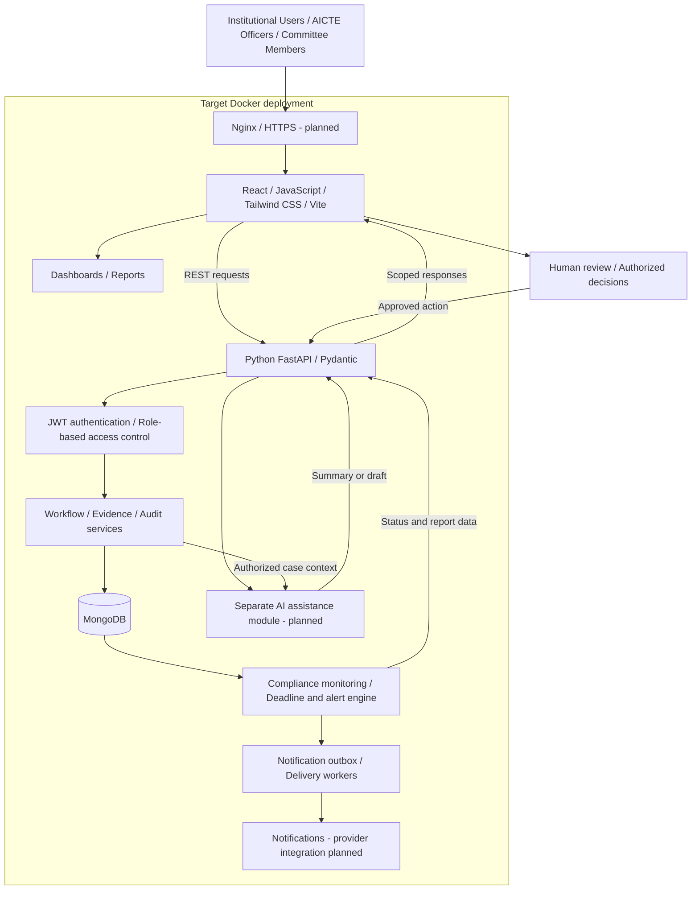
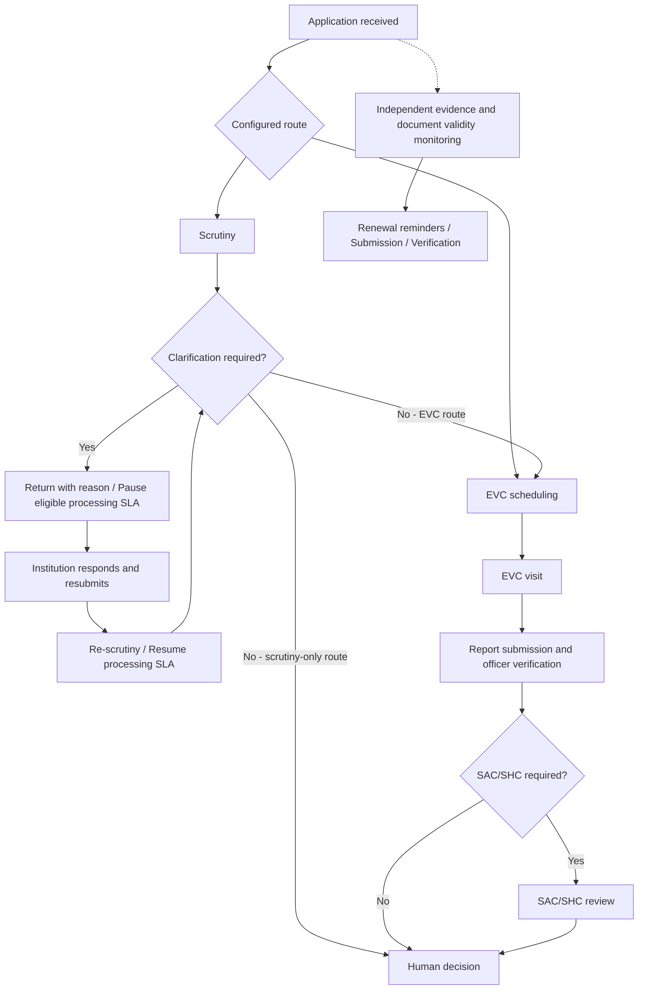
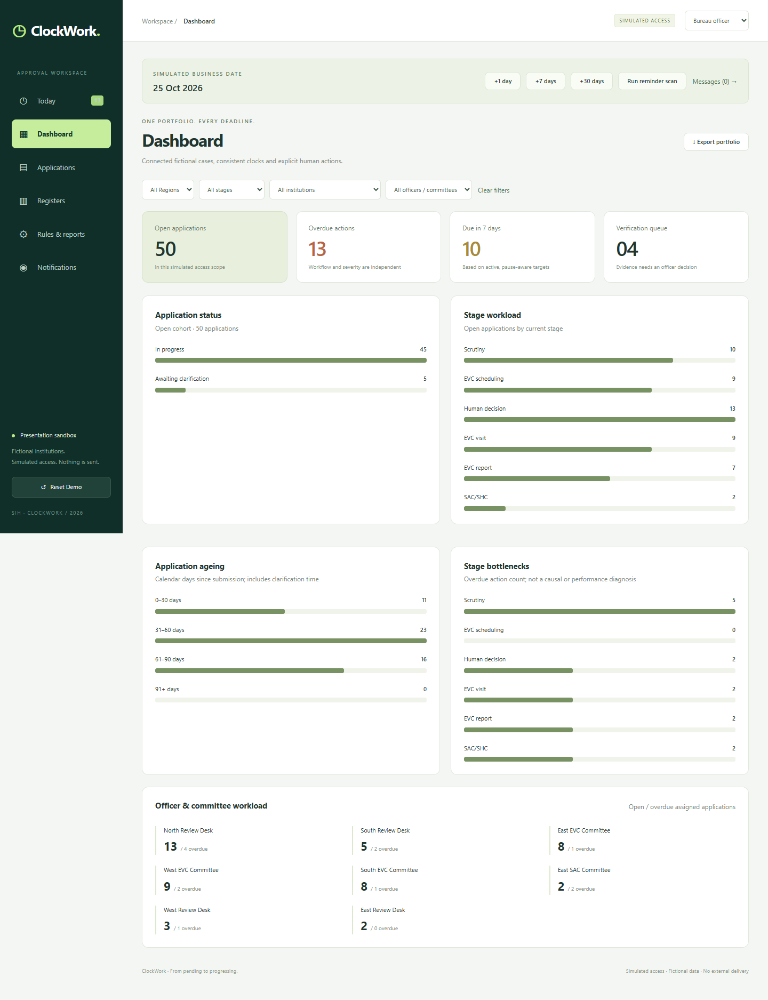
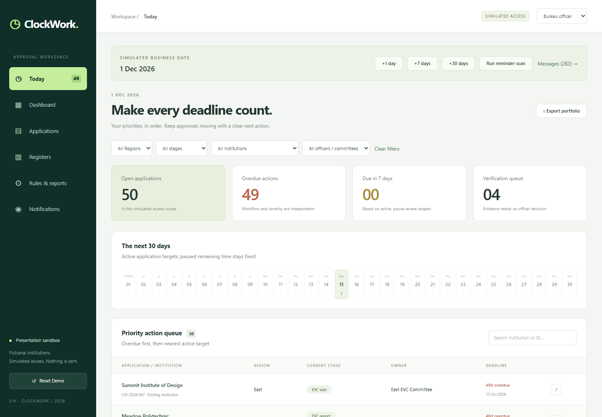
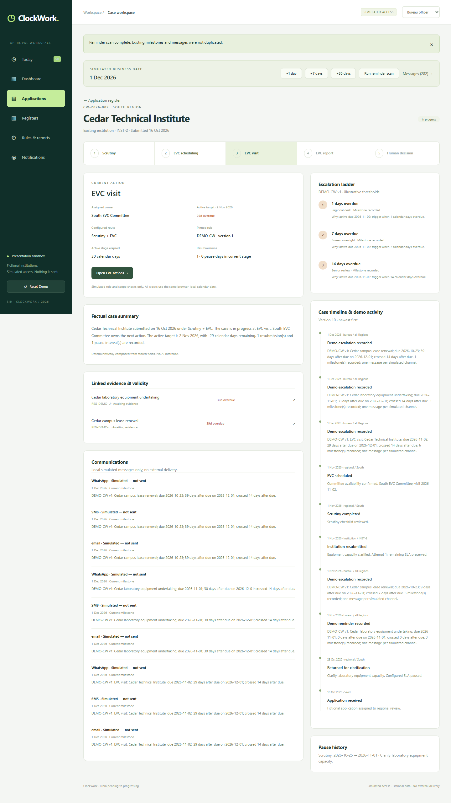
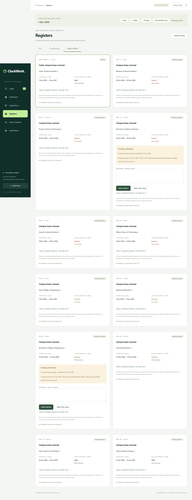
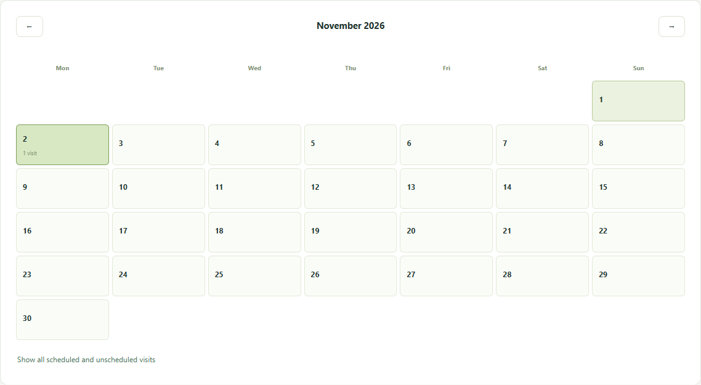
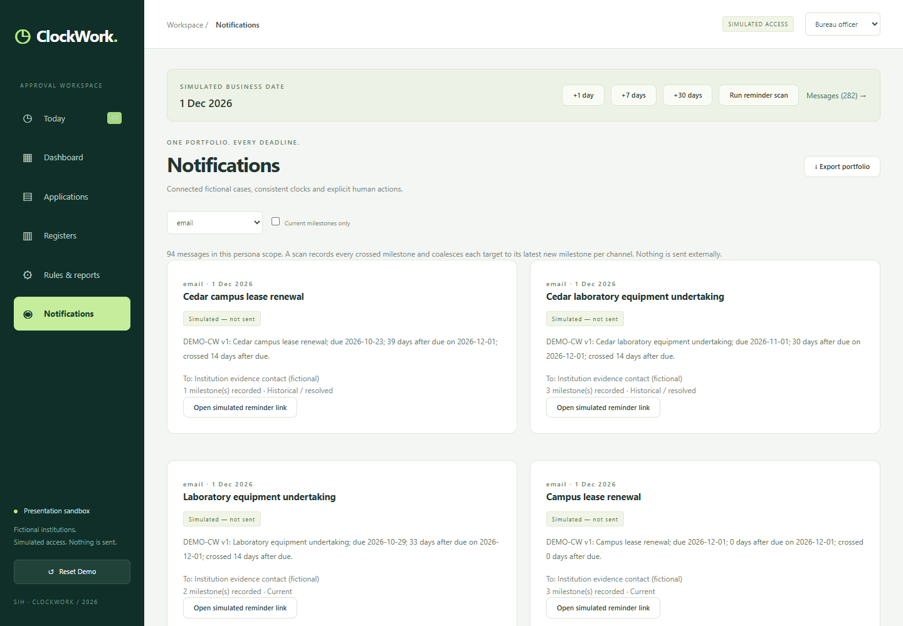
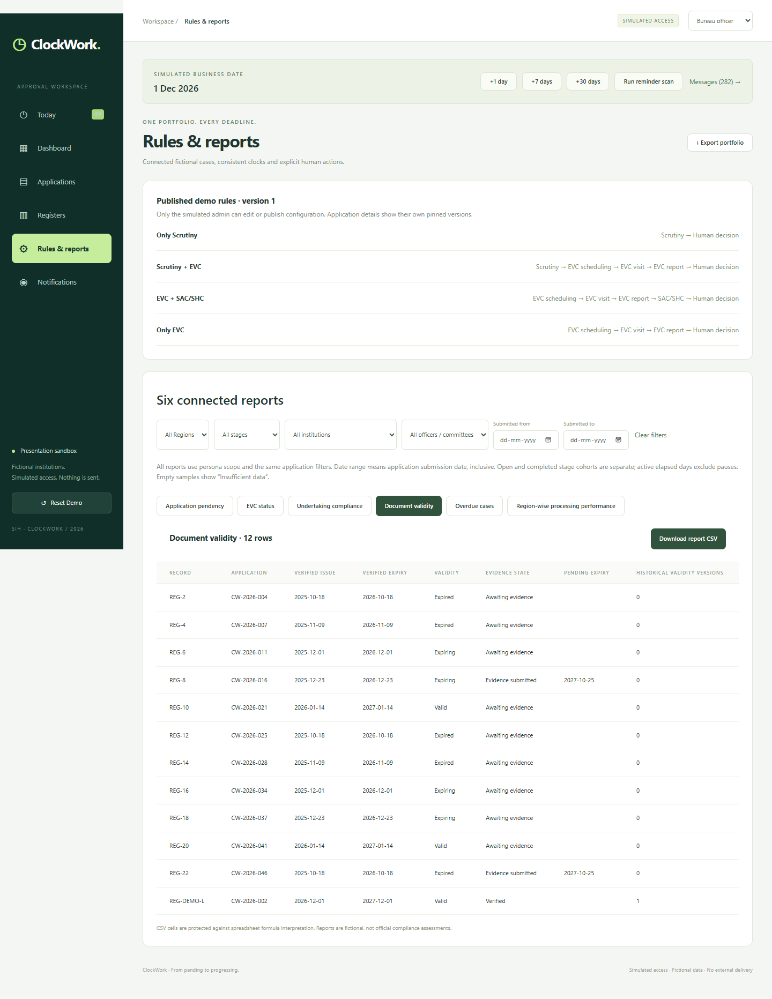
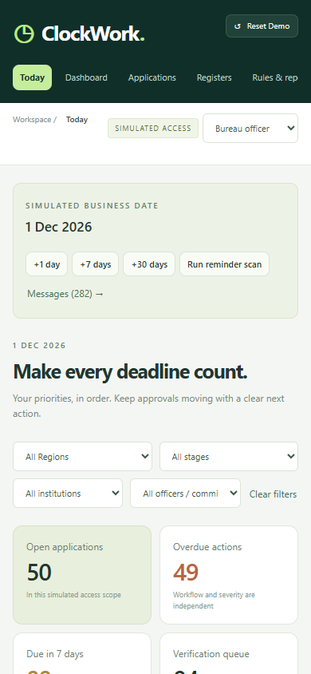

# ClockWork

### Institutional approval workflows, compliance visibility, and accountable follow-up

**Smart India Hackathon · Problem Statement 26262**

**Integrated AICTE Approval Workflow Automation, Compliance Monitoring and Alert Management System**


[Overview](#overview) · [Demo](#current-prototype-demonstration) · [Implementation status](#target-application-outcomes) · [Architecture](#target-system-architecture) · [Screenshots](#application-interfaces-and-screenshots) · [Run locally](#installation-and-local-execution) · [Validation](#testing-and-validation)

## Overview

ClockWork explores how institutional approval can become a coordinated digital process: each application has an identifiable stage, responsible actor, processing deadline, supporting evidence, and traceable next action. It brings scrutiny, re-scrutiny, Expert Visit Committee (EVC), and SAC/SHC activities into a shared workflow vision for institutional representatives, AICTE administrators, scrutiny officers, and authorized committee members.

The repository contains a working interactive presentation prototype and separately runnable backend foundations. Its intended outcome is an integrated platform that reduces manual follow-up, makes pending compliance visible, and supports timely human decisions.

> **Evaluation scope:** The default experience is a local React simulation with fictional records. A separate FastAPI/MongoDB foundation implements authentication and scoped reads; the preserved SQL backend implements earlier workflow operations. These are distinct runtimes, not one completed production system. No official AICTE integration, policy certification, or production deployment is claimed.

## Problem statement and existing challenges

PS **26262** calls for integrated approval workflow automation, compliance monitoring, and alert management. ClockWork addresses the following problem areas; these are design motivations, not measured findings about an existing AICTE system.

| Challenge | Design response |
|---|---|
| Fragmented application status and follow-up | A stage-based case record with ownership and action history |
| Repeated clarification cycles | Recorded return reasons, resubmission, and re-scrutiny visibility |
| Processing deadlines confused with document validity | Independent processing clocks and document-expiry dates |
| Pending evidence and renewals overlooked | Compliance registers that separate submission from verification |
| Committee hand-offs difficult to track | Explicit EVC scheduling, visit, report, and review steps |
| Delayed reminders and limited oversight | Prioritized work queues, explainable alert thresholds, and reports |

## Proposed solution

Provide a role-aware workspace backed by configurable workflow services, durable case and evidence records, and a deadline engine. Institutions submit and respond; officers scrutinize and verify; committees record assigned activities; administrators and oversight users monitor progress within authorized scopes. AI assistance is intended to summarize recorded facts and draft communications for review, while authorized humans retain verification and approval decisions.

## Key system capabilities

| Capability | Demonstrated behavior | Boundary / next implementation |
|---|---|---|
| Approval workflow management | Four configurable demo routes; scrutiny, return/resubmission, EVC and SAC/SHC stages; ownership, status, and timeline views | Browser transitions are local; re-scrutiny is represented by clarification/resubmission. MongoDB workflow writes remain planned |
| Role-based tracking | Institution, regional officer, committee, bureau, and administrator personas; separate API scope guards | Demo personas are presentation controls, not authentication. API permissions differ from demo visibility |
| Document compliance | Undertaking and lease-validity registers, pending evidence, verification/rejection, renewal history | Demo stores filename/size metadata, not uploaded file contents; durable secure evidence storage is planned |
| Deadline management | Independent processing and document deadlines, eligible-stage SLA pause/resume, due-date evaluation and ranked pending cases | Demo scans use a controllable clock; a production scheduler is absent |
| Alerts and escalation | Threshold explanations, simulated reminders/escalations and local history | Email, SMS, and WhatsApp entries are explicitly not sent; backend outbox primitives have no delivery worker |
| AI-assisted experience | Case summaries, pending-item explanations, recorded blockers, and reminder drafts | Deterministic local JavaScript templates; no AI model or inference API. Drafts require human review |

## Current prototype demonstration

**Fastest evaluator path:** run the frontend only, then open `http://127.0.0.1:5173`.

The default seed contains **60 fictional applications across four fictional Regions**. Changes persist in browser `localStorage`; clearing browser data removes them. Previously saved demo versions may retain older fixture counts until explicitly reset.

1. Open **Today** and **Dashboard** to inspect workload, deadlines, and stage distribution.
2. Inspect a case, its owner, route, return reason, and action history. Use the appropriate demo persona to return, resubmit, or complete eligible stages.
3. Review the EVC register and the separate scheduling, visit, report-submission, and report-verification states.
4. Submit sample evidence metadata, then switch persona to verify or reject it. Inspect lease renewal dates independently of workflow pauses.
5. Advance the demo clock or run a scan to inspect simulated reminder and escalation explanations.
6. Inspect case assistance and a reminder draft; review reports and filtered CSV exports.

See the [frontend walkthrough](docs/FRONTEND_DEMO.md) and [SIH coverage review](docs/SIH_DEMO_REVIEW.md). Use synthetic information only. The optional API mode has a smaller, separate foundation dataset and read interface.

## Target application outcomes

**Status key:** **Implemented** means present in the stated runtime; **Partial** means only part of the end-to-end capability exists; **Planned** means target work; **Not Verified** means execution or deployment has not been established by this audit.

| Capability | Current implementation | Target outcome |
|---|---|---|
| User interface | **Implemented (prototype):** React mobile-oriented dashboard, case views, registers, reports, and persona controls; separate API read UI | Production-ready responsive interface with accessibility validation |
| Application workflow | **Partial:** local demo transitions and legacy SQL workflow APIs; MongoDB foundation exposes scoped reads, not workflow writes | Backend-managed approval stages with transactional transitions and authorized decisions |
| Document compliance | **Partial:** browser metadata, validity, renewal and verification simulation; backend obligation schemas | Persistent evidence and validity management with secure file handling |
| Alerts | **Partial:** local scans and simulated channel entries; MongoDB transactional outbox foundation | Automated notification and escalation system with retries and delivery tracking |
| Authentication | **Partial relative to target:** MongoDB API implements opaque cookie sessions, password hashing, and role/scope guards; demo has no secure login | JWT authentication with role-based permissions, reviewed token lifecycle and revocation |
| Backend | **Implemented foundation:** Python/FastAPI/Pydantic services; separate preserved SQL runtime | Integrated FastAPI service layer for all demonstrated workflows |
| Database | **Implemented foundation:** MongoDB repositories, indexes, seed and transactions; legacy SQL persistence remains separate | MongoDB persistence for cases, evidence metadata, deadlines, audit and delivery state |
| AI assistance | **Partial (UX only):** local rule/template responses; no model integration | Integrated, scoped, human-reviewed AI assistance |
| Deployment | **Partial / Not Verified:** MongoDB-only Docker Compose configuration; no application Dockerfile or Nginx configuration found | Containerized frontend/API/worker deployment behind Nginx and HTTPS |

## Target System Architecture

The diagram below describes the **intended integrated deployment**, not the default demo or a deployed service. JWT, workflow write integration, alert delivery, model inference, and full application containers remain target work.



**Current execution paths:** default React demo → local JavaScript services → browser storage; optional React API mode → FastAPI `/api/v1` → MongoDB. The legacy `backend.main:app` SQL runtime is independent. There is no automatic SQL-to-MongoDB migration or shared demo/API state. See [architecture](docs/ARCHITECTURE.md), [API contract](docs/API_CONTRACT.md), and [data model](docs/DATA_MODEL.md) for foundation details.

## Complete technology stack

| Layer | Verified in this repository | Target / qualification |
|---|---|---|
| Frontend | React 19, JavaScript/JSX, Vite 8, Tailwind CSS 4, custom CSS, HTML entry point | Extend existing interface into the integrated application |
| Backend | Python 3.14+, FastAPI, Pydantic, Uvicorn, pydantic-settings | Workflow, evidence, reporting and worker integration |
| Database | MongoDB via PyMongo; preserved SQLAlchemy SQLite/PostgreSQL backend | MongoDB is the selected target; SQL cutover is not implemented |
| Authentication | Argon2-backed MongoDB authentication, opaque cookie sessions, server-side scope checks; legacy SQL uses its own session implementation | JWT is **planned**, not the current session mechanism |
| Testing | Node built-in test runner, Python `unittest`, Playwright, ESLint | Broader integrated workflow, accessibility, load and deployment coverage |
| Infrastructure | PowerShell/Python local tooling; Docker Compose for MongoDB only | Full Docker deployment and Nginx are **planned** |
| Assistance | Deterministic JavaScript case adapter | Model-backed service, authorization and output evaluation are **planned** |

Dependency versions are pinned in [frontend/package.json](frontend/package.json), [frontend/package-lock.json](frontend/package-lock.json), and the backend requirements files. [backend/pyproject.toml](backend/pyproject.toml) specifies Python `>=3.14`; the frontend manifest requires Node `>=22.13.0` (the existing setup documentation records Node 22.19.0).

**GitHub language detection:** meaningful tracked code includes Python, JavaScript/JSX, CSS, HTML, and PowerShell. No TypeScript implementation was found. YAML/JSON configuration, images, documents and badges do not establish additional application languages. [.gitattributes](.gitattributes) excludes generated artifacts from language statistics without reclassifying genuine source; exact percentages are computed by GitHub from committed files.

## Workflow explanation

Routes are illustrative and configurable; not every application passes through every stage. Timing values and committee mappings must be validated against approved institutional policy before operational use.



A processing pause does not suspend document validity. Evidence submission does not imply verification, and a completed administrative stage does not itself establish statutory approval. The [timing contract](docs/RULES_AND_TIMING.md) documents foundation semantics.

## Functional modules

| Module | Source and responsibility |
|---|---|
| Presentation workflow | [model.js](frontend/src/demo/model.js) and [service.js](frontend/src/demo/service.js): fixtures, routes, transitions, evidence metadata and simulated scans |
| Case and oversight interfaces | [demo screens](frontend/src/demo/screens): Today/dashboard integration, case detail, EVC, evidence, notifications and reports |
| Case assistance | [assistant.js](frontend/src/demo/assistant.js): scoped local facts, explanations and reviewable drafts |
| API authentication | [auth module](backend/app/modules/auth): session creation, revocation, identity and scope guards |
| Foundation read services | [backend modules](backend/app/modules): institutions, obligations and published rules |
| Timing and persistence | [engine](backend/app/engine), [database layer](backend/app/db), audit and notification repositories: clock separation, timing, transactions and outbox foundations |
| Legacy workflow | [workflow.py](backend/workflow.py): preserved SQL processing operations; not called by the default demo |

## Application interfaces and screenshots

These are existing captures of the **fictional presentation prototype**, not evidence of deployed backend integration. The tracked gallery below covers the main evaluation journey; later mobile/presentation assets also exist in the workspace.

| Main dashboard | Institutional application management |
|---|---|
|  |  |
| **Approval workflow tracking** | **Document compliance** |
|  |  |
| **Deadline monitoring and EVC activity** | **Alerts and notifications** |
|  |  |
| **Administrative overview and reports** | **Mobile interface** |
|  |  |

Screenshots may reflect an earlier presentation iteration; the source is authoritative for current labels and behavior. See [image attribution](docs/IMAGE_ATTRIBUTION.md) for illustrative campus photography used in newer screens; those photos are not verified institutional evidence.

## Project structure

```text
ClockWork/
├── frontend/
│   ├── src/demo/             # Default local presentation prototype
│   ├── src/app/              # Optional API-connected foundation shell
│   ├── src/features/         # API login, Today and rules interfaces
│   ├── src/lib/              # API client
│   ├── tests/                # Node unit tests and Playwright journeys
│   └── package.json          # Frontend scripts and pinned dependencies
├── backend/
│   ├── app/                  # Current FastAPI/MongoDB foundation
│   │   ├── api/              # Router and health endpoints
│   │   ├── core/             # Settings and error handling
│   │   ├── db/               # Lifecycle, indexes and transactions
│   │   ├── engine/           # Clock, rules and timing primitives
│   │   └── modules/          # Auth, institutions, obligations, audit, etc.
│   ├── scripts/              # Explicit MongoDB demo seed
│   ├── tests/                # Unit, integration and legacy tests
│   └── main.py               # Preserved SQL API entry point
├── config/                   # Mongo foundation demonstration rules
├── infra/                    # Local MongoDB replica-set tooling / Compose
├── clockwork-data-starter/   # Synthetic data, reference engine and checks
├── docs/                     # Architecture, contracts, walkthroughs and evidence
│   └── screenshots/          # Existing application captures
└── scripts/                  # Repository and presentation utilities
```

## Installation and local execution

### Prerequisites

- Git, Node.js compatible with the manifest (existing documented host: **22.19.0**), and npm.
- For the optional backend: **Python 3.14+**, a virtual environment, and **MongoDB 8.0.28** configured as a local replica set.
- For browser tests: installed Microsoft Edge; current Playwright configurations select `msedge`.
- Docker is optional for the MongoDB-only Compose alternative. It is not needed for the standalone demo.

### Frontend demo — no backend required

```powershell
git clone https://github.com/sumiya15/ClockWork.git
cd ClockWork
cd frontend
npm ci
npm run dev
```

Open **http://127.0.0.1:5173**. No environment file or account is required for default demo mode. If your shell already sets `VITE_APP_MODE=api`, set it to `demo` before starting Vite. On Windows, use `npm.cmd` if PowerShell execution policy blocks `npm.ps1`.

### Optional FastAPI / MongoDB foundation

The following PowerShell commands run from the repository root. Install the dependency lock and prepare MongoDB first:

```powershell
python -m venv .venv
.\.venv\Scripts\python.exe -m pip install -r backend/requirements-mongo-lock.txt
```

For a local Windows MongoDB executable, follow [the existing MongoDB setup instructions](docs/DEMO.md#prerequisites-and-isolation), then run:

```powershell
powershell -NoProfile -ExecutionPolicy Bypass -File infra/start_mongo.ps1
```

Alternatively, with a running Docker daemon, use `docker compose -f infra/compose.yaml up -d`. This configuration starts **only MongoDB** and was not execution-verified in this documentation audit. Do not start both options on port 27018.

Initialize the local replica set, seed the separate synthetic foundation database, and start the API:

```powershell
.\.venv\Scripts\python.exe infra/init_replica.py
.\.venv\Scripts\python.exe -m backend.scripts.seed
.\.venv\Scripts\python.exe -m uvicorn backend.app.main:app --host 127.0.0.1 --port 8002 --no-access-log
```

In another PowerShell terminal, from the repository root:

```powershell
cd frontend
npm ci
$env:VITE_APP_MODE = 'api'
npm run dev
```

Use **http://127.0.0.1:5173** consistently. The Vite proxy sends `/api` requests to port 8002. Example synthetic account: `institution_1.demo`; public demo-only password: `ClockWork-Demo-Only-2026!`. `bureau.demo` provides foundation oversight; `admin.demo` has published-rule access without operational read authority. Never use these shared credentials for real deployments.

[backend/.env.example](backend/.env.example) documents `CW_*` settings; defaults target loopback MongoDB on port 27018 and `clockwork_demo_local`. Backend environment files are **not automatically loaded**: set overrides in the shell. [frontend/.env.example](frontend/.env.example) documents the optional `VITE_API_BASE_URL`. Never put credentials in `VITE_*` variables. [Root .env.example](.env.example) belongs to the legacy SQL configuration.

See [foundation setup and shutdown](docs/DEMO.md) for account scopes and lifecycle instructions. The legacy SQL entry point remains available but is not required for this demo; its separate persistence and migration context is documented in [data-foundation verification](docs/DATA_FOUNDATION_VERIFICATION.md) and [Supabase setup](docs/SUPABASE_SETUP.md).

### Production frontend build

From `frontend/`:

```powershell
npm run build
npm run preview
```

Vite writes `frontend/dist/`. Preview is a local build check, not a production deployment. The default bundle remains the standalone demo; an API-mode build needs `VITE_APP_MODE=api` set before building and a production reverse proxy for `/api` (not supplied).

## System security and compliance considerations

- **Prototype boundary:** browser storage and persona controls are editable by the user. They provide no server-enforced confidentiality, authorization, or tamper resistance. Demo evidence links are simulations.
- **Existing API controls:** MongoDB foundation code uses password hashing, digest-backed opaque sessions, HttpOnly cookies, origin/CSRF checks, real-time expiry, and server-side scope restrictions. Inspect [authorization](docs/AUTHORIZATION.md) for the actual access matrix.
- **Audit boundary:** transactional audit/outbox primitives exist in the MongoDB foundation; local demo history is editable, and end-to-end audit coverage is unfinished.
- **Before operational use:** implement secure file storage and content validation, malware checks, encryption and key management, retention/deletion rules, backups and restoration, rate limiting, account administration, HTTPS, and reviewed production database access.
- **Policy and AI governance:** validate routes, SLA pause rules, escalation recipients and retention with authorized stakeholders. Scope AI context to authorized records, evaluate unsupported claims, and retain human review of drafts and decisions.
- **Repository hygiene:** keep real institution data, credentials and runtime databases out of Git. Example settings and synthetic fixtures are intentionally retained. Local security scripts and CI configuration do not establish certification or prove remote protection settings.

## Development roadmap

| Stage | Status | Completion objective |
|---|---|---|
| Presentation prototype | Implemented locally | Maintain an understandable, reproducible evaluator journey |
| MongoDB service foundation | Implemented, limited scope | Authentication, scoped reads, clock/rule contracts and transactional persistence primitives |
| Workflow integration | Planned | Port and test transitions, returns, re-scrutiny, pauses and committee actions against MongoDB |
| Evidence and compliance | Planned | Durable file handling, validity records, renewals and authorized verification |
| Scheduled alerts and reports | Planned | Background evaluation, idempotent delivery, retries, escalation and server-generated reporting |
| AI integration | Planned | Authorized case retrieval, evaluated summaries and reviewable drafts |
| Production hardening | Planned | JWT design, full Docker/Nginx setup, accessibility, load, recovery and security validation |

The [migration plan](docs/MIGRATION_PLAN.md) and [acceptance checklist](docs/ACCEPTANCE_CHECKLIST.md) provide deeper engineering context. Older status documents contain historical milestones and runtime assumptions; they should not be read as current deployment guarantees.

## Testing and validation

Commands below use existing tests and scripts. Run frontend checks from `frontend/`:

```powershell
node --test tests/demo-service.test.js tests/assistant.test.js tests/wording.test.js
npm run lint
npm run build
npx playwright test --config playwright.demo.config.js
```

The demo browser suite exercises UI workflows and mobile layout behavior with Edge and its own Vite server on port 5175. Additional presentation test configurations exist; several produce screenshot/video artifacts and are not substitutes for API integration tests. Existing UI checks do not establish complete accessibility or cross-device coverage.

Run Python checks from the repository root after installing the corresponding dependencies:

```powershell
# Independent of a running MongoDB server
.\.venv\Scripts\python.exe -m unittest backend.tests.unit.test_settings -v
.\.venv\Scripts\python.exe -m unittest discover -s clockwork-data-starter/tests -v

# Requires the local MongoDB replica set
.\.venv\Scripts\python.exe -m unittest backend.tests.integration.test_foundation -v
.\.venv\Scripts\python.exe -m backend.tests.integration.browser_runner

# Preserved SQL suites; requires backend/requirements-lock.txt dependencies
.\.venv\Scripts\python.exe -m unittest discover -s backend/tests -v
```

The foundation browser runner uses disposable MongoDB test databases and requires free ports 8002/5173. Keep it separate from a running development API/client. Historical test evidence is in [workflow verification](docs/WORKFLOW_VERIFICATION.md) and [foundation verification](docs/DATA_FOUNDATION_VERIFICATION.md); fresh documentation-audit results and limitations are recorded in [repository presentation audit](docs/REPOSITORY_PRESENTATION_AUDIT.md).

## Expected impact and benefits

The intended platform would give institutions clearer pending actions, officers a prioritized work queue, committees explicit assignments, and administrators a consolidated view of delays and compliance. Independent deadline tracking should help prevent processing pauses from hiding document expiry. Traceable reasons and reviewable communications should improve accountability.

These are expected benefits, not measured operational results. A pilot should assess processing turnaround, overdue cases, renewal completion, notification delivery, user task completion and decision traceability before claiming improvements.

## Future enhancements

- Authorized integrations with institutional systems and approved communication providers.
- Document extraction and validation assistance with evidence provenance and human verification.
- Multilingual guidance, stronger accessibility, and broader device/browser coverage.
- Policy-version simulation, workload forecasting, and explainable operational analytics.
- Evaluated model-backed assistance with monitoring, feedback, and controlled rollout.

## Team and acknowledgements

**Repository:** [sumiya15/ClockWork](https://github.com/sumiya15/ClockWork) · **SIH problem statement:** 26262.

The repository does not yet identify a verified SIH team roster, mentor list, or institutional affiliation. Add those details before submission. This project is an independent prototype addressing the supplied problem statement; it does not imply endorsement by AICTE or SIH.

Acknowledgements: the React, Vite, Tailwind CSS, FastAPI, Pydantic, MongoDB and Playwright ecosystems; the included synthetic data/reference kit; and the image sources recorded in [image attribution](docs/IMAGE_ATTRIBUTION.md). Synthetic rules and illustrative records require stakeholder validation before real use.
